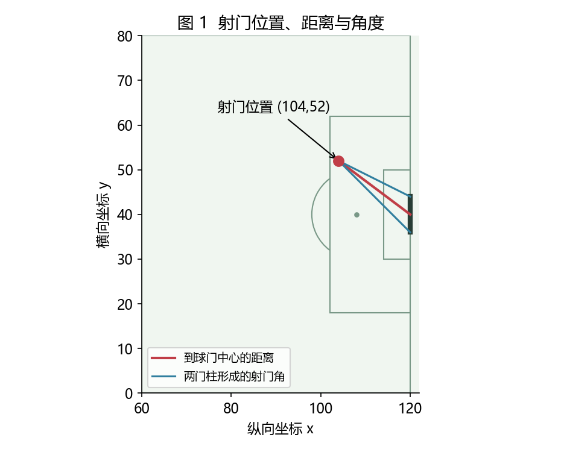
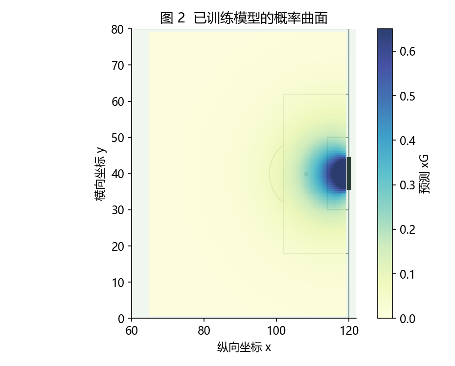
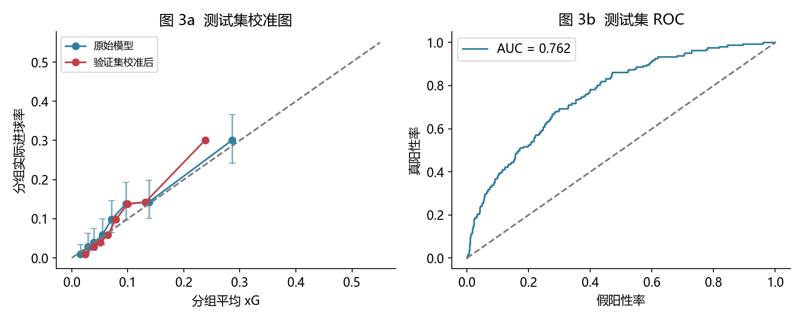
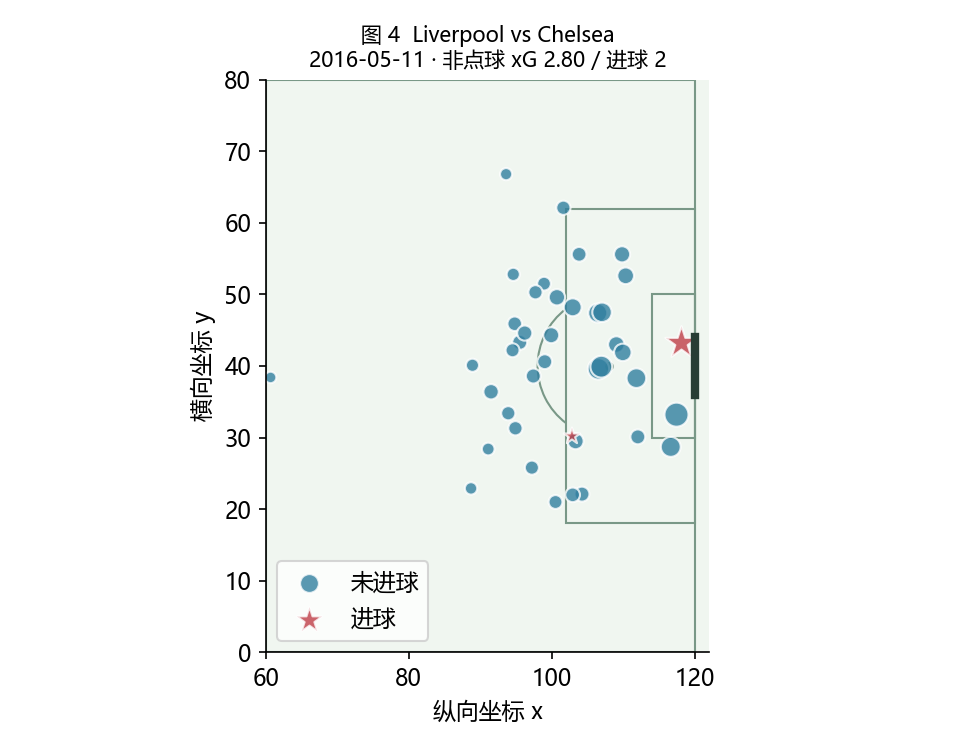

# 一次射门有多大概率进球？——足球 xG 模型的建立与验证

## 关键信息

| 项目 | 内容 |
| --- | --- |
| 涉及的概率论知识点 | 条件概率、伯努利分布、条件期望、期望的线性性、最大似然估计；拓展：贝叶斯估计与概率校准 |
| 实际应用场景 | 用射门发生时的位置和条件估计进球概率，评价机会质量；结合公开比赛数据训练并验证足球 xG 模型 |
| 延伸的专业课程知识 | 逻辑回归、特征编码、正则化、训练/验证/测试划分、概率预测评价、数值优化 |

完成日期：2026 年 10 月 13 日。适用对象：已学习条件概率、随机变量及数学期望的同学。建议安排：原理讲解 25 分钟，训练与验证 25 分钟，交互实验与讨论 10 分钟。

## 案例说明

足球比赛中，射门次数相同的两支球队，获得的机会未必同样好。xG（expected goals，预期进球）给每次射门分配一个进球概率：例如 xG 为 0.20，表示模型估计这种射门条件下的进球概率为 20%。

本案例用 StatsBomb Open Data 中 **2015/16 赛季英超**的实际射门数据，自行训练一个可解释的逻辑回归模型。目标不是复刻商业 xG，而是完成“概率定义—数据建模—参数估计—独立验证”的过程。

## Problem Setup：把射门写成概率问题

### 1. xG 是什么条件下的概率？

令随机变量 $Y$ 表示一次射门的结果，进球时 $Y=1$，否则 $Y=0$。令 $X$ 表示射门条件，包括距离、角度、射门部位、射门类型、是否受压和是否直接射门。定义

$$
p(x)=P(Y=1\mid X=x),\qquad Y\mid X=x\sim\operatorname{Bernoulli}(p(x)).
$$

因此 $E[Y\mid X=x]=p(x)$，$\operatorname{Var}(Y\mid X=x)=p(x)(1-p(x))$。一次射门的 xG 就是条件进球概率，也等于条件期望。

模型输出的是对 $p(x)$ 的估计 $\hat p(x)$。它依赖所选特征与训练样本，不能理解为某个球员这次射门的“真实概率”。射门之后的轨迹、门将扑救结果和球的终点，不属于本案例的条件信息。

对于连续的射门位置，$P(X=x)$ 通常为零。这里的条件概率通过条件分布定义；实践中用相似射门的信息和模型假设进行估计，不能直接套用 $P(A\cap B)/P(B)$ 对精确坐标作频数计算。

### 2. 为什么把距离和角度作为特征？

StatsBomb 使用 $120\times80$ 的场地坐标，进攻球门中心为 $(120,40)$，两门柱为 $(120,36)$、$(120,44)$。这些是标准化坐标单位，**不是直接以米计量**。

设射门位置为 $s=(x,y)$，门柱为 $g_1,g_2$，则

$$
d=\sqrt{(120-x)^2+(40-y)^2},\qquad
\alpha=\operatorname{atan2}\left(|(g_1-s)\times(g_2-s)|,(g_1-s)\cdot(g_2-s)\right).
$$

二维叉积取其标量绝对值，角度 $\alpha$ 以弧度表示。距离相近的射门也可能具有不同角度，所以仅用距离会丢失位置的信息。



## Methodology：从条件概率到训练模型

### 不同条件下的进球概率分别表示什么？

需要区分“机会质量”与“执行质量”。距离、角度、防守压力等描述射门发生时的机会，本来就是 xG 的条件。球踢出后实际的球速、落点和是否射正描述执行结果；如果加入这些信息，估计的是射门后的进球概率，通常称为 post-shot xG，而不是本案例的射门前 xG。

条件概率的意义取决于我们已知哪些信息、在什么时点进行预测。设 $X$ 为射门前条件，$Q$ 为射门后的执行信息：

| 条件信息 | 估计的概率 | 评价意义 |
| --- | --- | --- |
| 射门前的位置、角度、压力等 $X$ | $P(Y=1\mid X)$ | 普通 xG：评价获得的进球机会，尚未观察本次实际的落点与球速 |
| 上述条件及实际落点、球速等 $(X,Q)$ | $P(Y=1\mid X,Q)$ | 射门后 xG：评价执行后的进球可能性，可用于分析射门执行或门将扑救 |

两种条件概率都可以建模。增加执行信息后，概率的含义也随之改变；是否构成信息泄漏，要根据任务规定的预测时点判断。

令 $X$ 为射门前条件，$Q$ 为射门后的执行信息，两种模型分别估计 $P(Y=1\mid X)$ 和 $P(Y=1\mid X,Q)$。它们由全概率公式联系：

$$
P(Y=1\mid X)=E\left[P(Y=1\mid X,Q)\mid X\right].
$$

射门前模型将尚未发生的执行结果平均掉，适合评价获得的机会；射门后模型还评价实际踢得怎样。同一机会的一次射门偏出、另一次射向死角，射门前 xG 可以相同，射门后估计则不同。后者并非不能建模，但射门前尚不可用的特征会造成这个预测任务的时间泄漏；若直接把“是否进球”或据结果打出的质量评分作为输入，还会发生标签泄漏。

### 1. 用逻辑回归表示条件概率

把连续特征标准化，把射门部位与类型编码为独热向量，得到特征向量 $\phi(x)$。逻辑回归设定

$$
\hat p_\theta(x)=\sigma(\theta_0+\theta^\mathsf{T}\phi(x)),\qquad
\sigma(z)=\frac{1}{1+e^{-z}}.
$$

等价地，$\log\frac{\hat p}{1-\hat p}=\theta_0+\theta^\mathsf{T}\phi(x)$，即对数胜算随特征线性变化。Sigmoid 将实数映射到 $(0,1)$；它成为进球概率模型，还需要伯努利标签、相应的训练目标和数据验证。仅将数值限制在 $[0,1]$ 内不足以证明它具有正确的概率含义。

### 2. 为什么最小化对数损失？

对射门样本 $(x_i,y_i)$，伯努利模型给出的似然为

$$
L(\theta)=\prod_{i=1}^n \hat p_i^{y_i}(1-\hat p_i)^{1-y_i},\qquad
\hat p_i=\hat p_\theta(x_i).
$$

取负对数并除以样本数，得到二分类交叉熵，也称对数损失：

$$
\ell(\theta)=-\frac1n\sum_{i=1}^n\left[y_i\log\hat p_i+(1-y_i)\log(1-\hat p_i)\right].
$$

最小化它对应最大似然估计。训练还加入 $L_2$ 正则化，限制参数过大；代码用验证集选择参数 $C$，$C$ 越小，正则化越强。数值求解交给 scikit-learn 的优化器。

上式采用样本条件独立的工作假设。实际同场比赛的射门可能相关，因此评估置信区间时按整场比赛重抽样，而不是把每次射门都当作独立观测。

### 3. 数据处理与验证规则

原始数据共 9,907 次有效射门，其中非点球 9,816 次，点球 91 次。主模型只训练非点球；排除无效坐标和点球大战事件。进球标签来自 `shot.outcome`，只用于构建 $Y$，不进入特征。

| 特征 | 处理方式 |
| --- | --- |
| 射门距离、射门角度 | 按训练集均值和标准差标准化 |
| 射门部位、射门类型 | 独热编码；测试中新类别采用全零编码 |
| 受压、直接射门 | 0/1 指示变量；按数据规范，未标注视为否 |

不使用官方 `statsbomb_xg`，不使用射门终点或结果类字段，也不对少数进球样本过采样。否则可能发生答案泄漏，或改变原始进球比例，影响概率估计。

按比赛日期的先后，约以 60%/20%/20% 的**比赛日**划分数据，同一天和同一场比赛不会跨集合。这不是按射门数量精确划分。

| 集合 | 日期范围 | 比赛数 | 非点球射门数 | 非点球进球数 |
| --- | --- | ---: | ---: | ---: |
| 训练集 | 2015-08-08 至 2016-01-24 | 230 | 5851 | 532 |
| 验证集 | 2016-02-02 至 2016-04-09 | 90 | 2336 | 215 |
| 测试集 | 2016-04-10 至 2016-05-17 | 60 | 1629 | 166 |

训练集拟合标准化、编码器和模型；验证集在 $C\in\{0.01,0.1,1,10\}$ 中选择对数损失最低者；测试集只用于最终评价。另在验证集上拟合 Platt 校准器，作为预先设置的对照，不依据测试结果重新选模型。它将原始对数胜算 $z$ 再映射为 $\sigma(az+b)$，只调整概率尺度，不重新拟合射门特征。

### 4. 怎样验证预测的概率？

**对数损失与 Brier 分数越小越好。** Brier 分数是 $\frac1n\sum_i(\hat p_i-y_i)^2$。若条件进球概率为 $p(x)$，预测值为 $q$，则

$$
E[(q-Y)^2\mid X=x]=(q-p(x))^2+p(x)(1-p(x)).
$$

右边第二项与 $q$ 无关，因此期望 Brier 损失在 $q=p(x)$ 时最小。这解释了为什么概率预测也可以用平方误差评价。

**AUC 衡量排序，校准图检查概率大小。** AUC 可理解为随机抽取一例进球与一例未进球，模型给进球例更高分的概率（同分计半）。它不能单独证明预测的 20% 对应约 20% 的实际进球率。校准图将测试射门按预测概率分为 8 个等样本量组，比较每组平均 xG 与实际进球率。

## Result：实际训练与验证结果

### 1. 模型比较

以下结果由随附脚本实际训练并生成；固定进球率基线使用训练集非点球进球率 9.09%。主模型选择的 $C=10$。

| 模型 | 对数损失 ↓ | Brier ↓ | AUC ↑ | 平均 xG |
| --- | ---: | ---: | ---: | ---: |
| 固定进球率基线 | 0.3299 | 0.0916 | 0.5000 | 9.092% |
| 距离 + 角度 | 0.2984 | 0.0855 | 0.7374 | 9.250% |
| 距离 + 角度 + 射门条件（主模型） | 0.2885 | 0.0832 | 0.7619 | 9.113% |
| 主模型 + Platt 校准 | 0.2900 | 0.0836 | 0.7619 | 9.068% |

测试集实际非点球进球率为 10.19%。主模型的 AUC 为 0.762；按比赛进行 1,000 次 Bootstrap 后，95% 百分位区间为 [0.729, 0.795]。相对常数基线的 Brier 改善为 0.0084，区间为 [0.0046, 0.0121]。

如果把所有射门都判为“不进球”，准确率仍有 89.81%，但无法区分机会质量。主模型平均 xG 为 9.11%，低于测试集实际进球率；总预测为 148.5，实际进球 166。这提示应检查概率尺度，而不是只看排序指标。上述 Bootstrap 区间反映固定模型在本测试比赛上的评估波动，不包含重新采样训练数据带来的参数不确定性。



图 2 固定为右脚、运动战、不受压、非直接射门，只改变位置。它表示模型的估计，不是所有位置的真实进球概率；样本稀少的位置可能有较大误差。



图 3a 的误差条为分组进球率的 Wilson 95% 区间，是二项近似，未处理组内的比赛相关性。它用于辅助观察，不等同于整体模型的置信区间。校准后的模型可能在新数据上变好，也可能变差，应同时报告原始模型与校准模型的结果。

本次校准后的对数损失和 Brier 分数均略高于原始模型，AUC 不变。校准映射的斜率为正，因此保持排序；验证集上的概率调整未改善后续测试集，可能与有限样本和时间变化有关，不能仅据此确定原因。

### 2. 怎样解释一场比赛的 xG？

给定已发生的 $m$ 次射门及其特征，令 $G=\sum_jY_j$。由期望的线性性，

$$
E[G\mid X_1=x_1,\ldots,X_m=x_m]
=\sum_{j=1}^m P(Y_j=1\mid X_1=x_1,\ldots,X_m=x_m)
\approx\sum_{j=1}^m\hat p(x_j).
$$

线性性本身不要求各次射门独立；最后一步还假设其他射门的信息对本次条件进球概率的影响可忽略。这是对已发生射门的事后机会评价，不是赛前的预期进球预测。



图 4 选取测试集中非点球射门次数最多的比赛，圆点大小对应 xG，星号表示进球。实际进球数与 xG 总和可以不同；单场偏差不能直接判断模型是否有效。

若额外假设射门结果条件独立，可进一步得到 $\operatorname{Var}(G\mid X)\approx\sum_j\hat p_j(1-\hat p_j)$ 及“至少一球”的概率 $1-\prod_j(1-\hat p_j)$。足球中的补射、比分变化等会影响这个假设，不能无条件使用。

### 3. 点球与贝叶斯估计（拓展）

点球位置几乎固定，单独建模更清楚。训练集有 55 次点球，47 次进球。取 $p_{\mathrm{pen}}\sim\operatorname{Beta}(1,1)$，观察 $n$ 次中 $k$ 次进球后，后验为 $\operatorname{Beta}(k+1,n-k+1)$，后验预测进球概率为

$$
E[p_{\mathrm{pen}}\mid D]=\frac{k+1}{n+2}=0.842.
$$

测试集中有 20 次点球，14 次进球。样本量较小，不能据此精确区分球员能力；交互 demo 的点球模式采用上述固定估计。

### 4. 亲手完成的实验

打开 `01_xG模型训练与验证.ipynb`，逐格执行数据检查、特征构造、模型拟合与测试评价。Notebook 随附已经执行的输出，并展示真实测试射门的预测值。

打开 `交互demo.html`，改变射门位置、部位和场景，观察同一位置下条件概率如何变化。它使用本案例训练出的参数，不调用官方 xG 或在线接口。再选择测试集中的真实射门，将预测概率与其结果一起查看；一次成功或失败不构成对概率值的检验。

课堂讨论：为什么全猜“不进球”也有高准确率？两个模型 AUC 相同，概率是否一定同样可信？一场比赛 xG 为 2.0，为什么不表示一定进两球？

### 5. 适用范围与局限

本模型没有使用门将位置、防守球员分布、传球过程或球员能力，逻辑回归也限制了特征的非线性作用。数据仅来自一个联赛的一个赛季，时间划分验证仍不能证明它能迁移到其他联赛。本案例不声称达到 StatsBomb 商业模型的效果。

## 代码链接与复现

- [已执行的训练 Notebook](01_xG模型训练与验证.ipynb)
- [数据下载、训练和验证脚本](main.py)
- [交互演示](交互demo.html)
- [完整实验记录](results/summary.json) · [测试预测](results/test_predictions.csv)
- [数据来源与校验记录](data/source_manifest.json) · [运行说明](README.md)

```powershell
python -m pip install -r requirements.txt
python main.py train
```

本机目录内已保留提取后的射门 CSV，上述命令可离线训练。首次在其他机器使用时，运行 `python main.py all` 从固定版本的官方公开仓库下载比赛事件并提取数据。为遵守数据许可，交付 ZIP 不再分发原始事件、射门 CSV 和逐条测试数据。随机种子为 20261013，实际环境版本见实验记录。所有正文公式保留为可编辑 LaTeX；飞书导入后若公式未自动识别，可粘贴到原生公式块，勿转为图片。

## 参考资料

1. [StatsBomb Open Data（Hudl 官方仓库）](https://github.com/hudl/open-data)：比赛事件数据、许可与字段规范。
2. [Hudl / StatsBomb：Expected Goals Explained](https://www.hudl.com/blog/expected-goals-xg-explained)：xG 的定义与常见影响因素。
3. [scikit-learn：LogisticRegression](https://scikit-learn.org/stable/modules/generated/sklearn.linear_model.LogisticRegression.html)：模型与正则化参数。
4. [scikit-learn：Probability calibration](https://scikit-learn.org/stable/modules/calibration.html)：校准曲线与概率校准。
5. [StatsBomb：Upgrading Expected Goals](https://statsbomb.com/articles/soccer/upgrading-expected-goals/)：机会质量与包含落点、球速的执行质量模型。

数据来源：StatsBomb Open Data。使用和再发布须遵守附带的 `data/LICENSE.pdf`；对外发布需按官方说明注明 StatsBomb 并使用其标识。本案例借助 AI 辅助编写讲解与代码；指标和图表来自实际训练、测试与程序检查，未填造实验结果。


